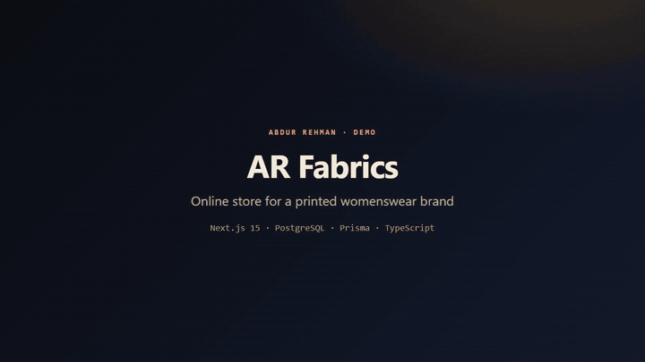
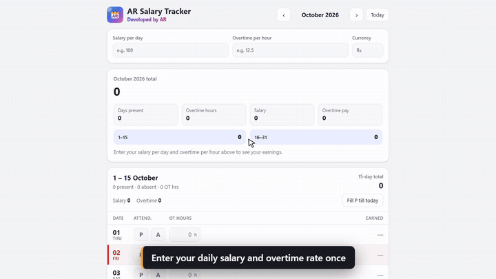

# Abdur Rehman — Case Studies

**ERP Developer · AI & Automation Engineer · Android Developer** — Pakistan, working with clients worldwide

I build business systems that companies run on every day: custom ERP/MIS software, AI assistants that answer from live data, camera systems that stop a machine when a person is in danger, online stores and Android apps.

This repository holds **demos, screenshots, diagrams and write-ups** of that work. Source code for client systems stays private, and every screen shown here uses demo data or is blurred.

[Portfolio website](https://abdurrehman629.github.io) · [LinkedIn](https://www.linkedin.com/in/abdur-rehman-ar03247440629) · [Email](mailto:gabdurrehman493@gmail.com) · [GitHub](https://github.com/ABDURREHMAN629)

---

## Featured: systems running in a real factory

| | |
|---|---|
|  | ### [Textile Mill ERP](case-studies/01-textile-mill-erp/README.md) Replaced a single-user Access database at a textile mill with a web ERP that **7 departments use at the same time**. 45 screens, 79 tables, lot tracking from fabric receipt to dispatch, reports that send themselves, verified nightly backups.  `React` `Node.js` `Express` `MySQL` `Android` |
|  | ### [ERP Assistant — ask by text or voice](case-studies/02-erp-ai-assistant/README.md) Staff ask questions in plain words and get the same figure the report shows. Respects each user's permissions, never writes data itself, and runs fully on the factory server.  `Node.js` `NLU` `Voice input` |
|  | ### [AI Machine-Safety Interlock](case-studies/03-ai-machine-safety-interlock/README.md) 15 cameras watch a production line. When a person enters a danger zone, the nearby machine is **stopped through the PLC**. Fail-safe by design.  `Python` `YOLOv8` `OpenCV` `Modbus` `Delta PLC` |

## Web products

| | |
|---|---|
|  | ### [AR Mobiles — online store](case-studies/04-ar-mobiles-store/README.md) Mobile-accessories store for Pakistan: phone-model compatibility catalogue, delivery tiers by area, and Cash on Delivery that stops fake orders.  `Next.js 15` `TypeScript` `MySQL` |
|  | ### [AR Fabrics — clothing brand store](case-studies/05-ar-fabrics-store/README.md) Store and admin panel for a printed-womenswear brand: collections, filters, stock by size and colour, checkout and order tracking.  `Next.js 15` `PostgreSQL` `Prisma` |
|  | ### [ClotheBrand — store with card payments](case-studies/06-clothebrand-store/README.md) Customer accounts, cart, Stripe card payments, order history and an admin dashboard.  `Next.js 16` `React 19` `Prisma` `Stripe` |
|  | ### [ToolNest — 150+ online tools](case-studies/07-toolnest/README.md) 152 PDF, image, video and text tools that run inside the browser, so files are never uploaded. SEO-ready static site.  `JavaScript` `Node.js` |
|  | ### [AR-Developer Mesh — private network](case-studies/08-ar-developer-mesh/README.md) Gives every PC a permanent fixed address, so a server stays reachable when the internet provider changes its IP. Admin panel, Windows installer, Android client.  `WireGuard` `SQLite` `Windows` `Android` |

## Android apps

| | |
|---|---|
|  | ### [Android apps](case-studies/09-android-apps/README.md) AR Salary Tracker, AR Notes, AR Stride (fitness), VoltCore (battery monitor), No Repeat Songs and AR Reader. Offline-first apps that keep data on the phone.  `Kotlin` `Jetpack Compose` `Capacitor` |

---

## What I can build for you

- **Custom ERP / MIS** — production, stock, orders, dispatch, payroll and reports in one system
- **Moving off Excel or Microsoft Access** — your history comes with you, nothing lost
- **AI assistants** inside your software that answer from your own data
- **Computer vision** — detection, counting, safety zones, PLC integration
- **Automation** — scheduled reports by email or WhatsApp, verified backups, audit trails
- **Online stores, web apps and Android apps**

**Have a problem like these?** [Send me an email](mailto:gabdurrehman493@gmail.com) or message me on [LinkedIn](https://www.linkedin.com/in/abdur-rehman-ar03247440629).
