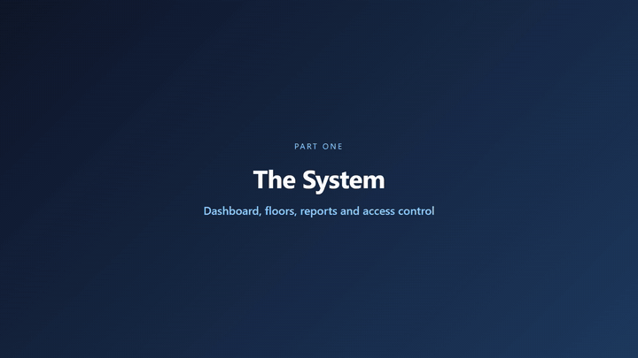
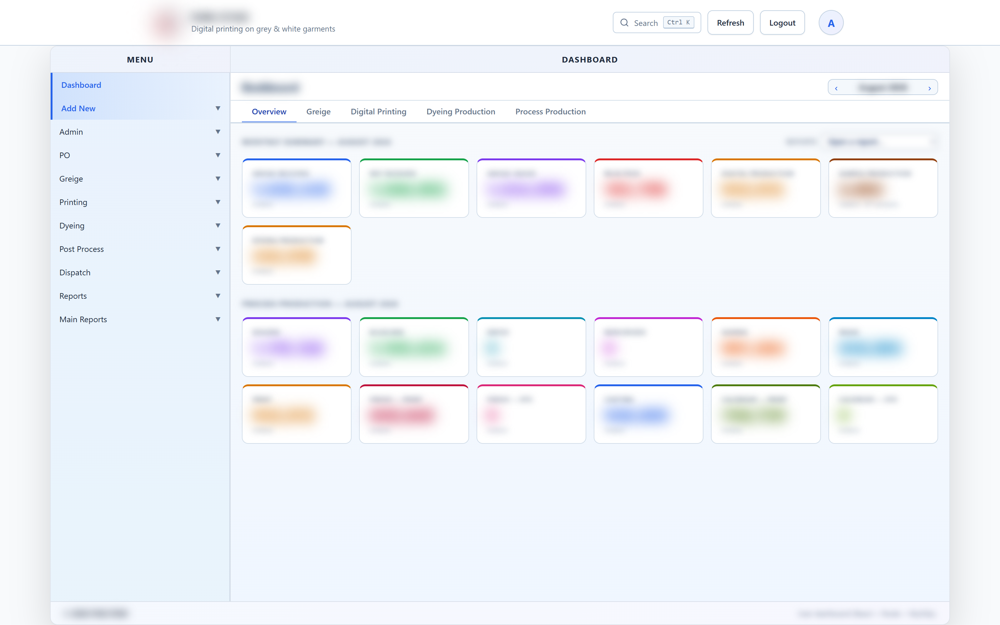
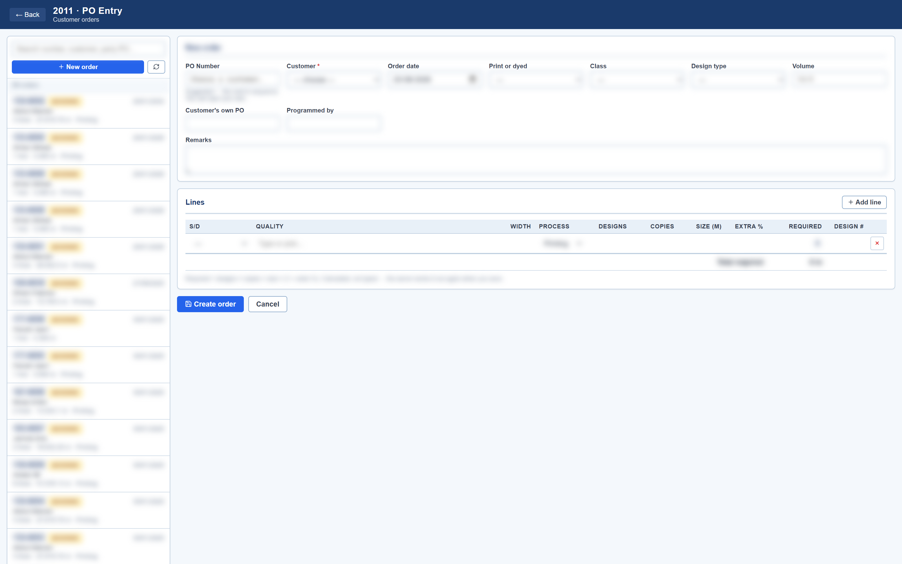
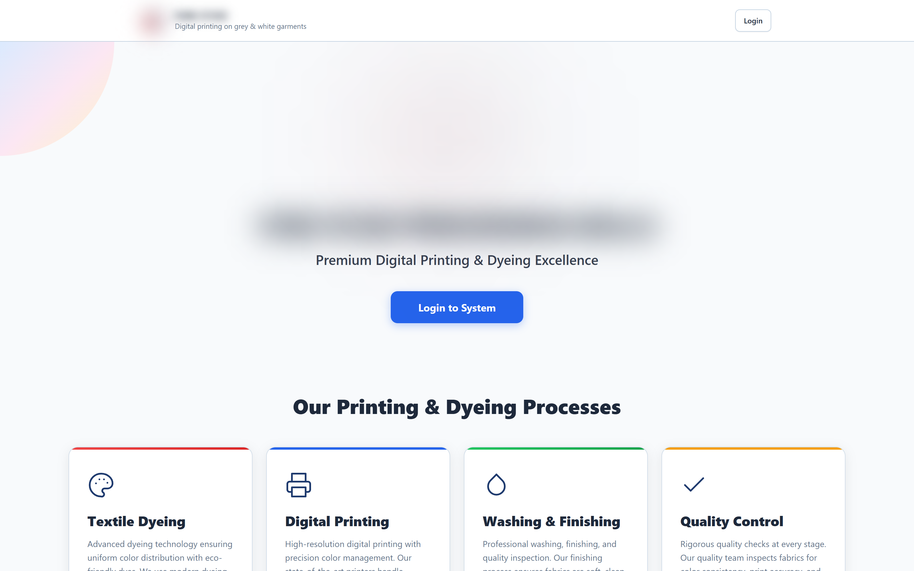
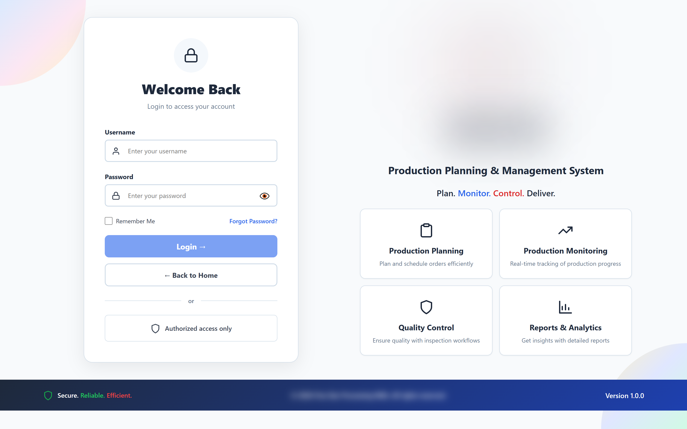

# Textile Mill ERP

**Client:** a textile processing mill (printing, dyeing and finishing) · **Status:** live, used every day · **Role:** sole developer, from the database schema to deployment, backups and user accounts

[← All case studies](../../README.md)

▶ **[Watch the full 2-minute walkthrough (MP4)](../../media/videos/textile-mill-erp-walkthrough.mp4)**. It was recorded on a demo database, so every name and number is made up.

---

## The problem

All of the mill's records were in one Microsoft Access file. Access locks the file, so **only one person could enter data at a time**. Greige, printing, dyeing, post-process and dispatch all work at once, so staff either waited for the database or wrote on paper and typed it in later. Management was always looking at yesterday's figures.

- Nobody could see where a lot was without asking several people
- Rows could be changed or deleted with no record of who did it
- End-of-shift reports were put together by hand in Excel
- One corrupted file would have lost years of history

## What I built

A web application on the factory's own network. Staff use it in a browser on office PCs and production-floor tablets, so nothing has to be installed or updated on each machine. Every department enters its own data **at the same time** into one MySQL database, and every entry is tied to a lot.

| Area | What it covers |
|---|---|
| Greige | receiving, issuance, returns, rejection, lot transfer |
| Production | printing and dyeing entries with machine and operator |
| Post-process | every stage from singeing to finishing and calendering |
| Dispatch | packing, gate passes, dispatch and shortage tracking |
| Reports | 14 live reports with one-click Excel export |
| Admin | user accounts, per-screen access for 20+ roles, notifications |

**Size:** 45 screens · 79-table database · 31 API modules · tablet layouts · Android companion app

## Screenshots

These come from the real system. Every value is blurred before capture: the redaction blurs **all** text by default and shows only menus, headings and column labels.

| Dashboard | Purchase-order status |
|---|---|
|  |  |
| **PO entry** | **Production charts** |
|  |  |
| **Landing page** | **Login** |
|  |  |

## Harder problems I solved

### Moving years of history out of Microsoft Access
A new system that started empty would have lost the mill's history, and nobody trusts a system that has forgotten everything. I wrote migration tooling that moved every record from a 60-table Access database into MySQL:

- Table names with spaces are quoted differently in Access and MySQL, so every query was written for both
- Foreign keys required a hand-written insert order for 39 tables, parents first
- "Dates" that were blank or half-typed become empty values instead of failing the whole row
- When a batch fails, it is retried row by row and the exact broken row is logged
- The migration can be **re-run safely** and always ends in the same clean state. It never touches user accounts.

### Reports that send themselves
A scheduled job emails a production summary twice a day: in the evening for the day just worked, and at the next midday with the settled figures after late entries. It runs the same queries as the dashboard, so the email and the screen always match. WhatsApp is a second channel.

### Backups that check themselves
Every night the database is copied without locking anyone out, then compressed, **verified**, uploaded off-site and kept for 30 days. The verification matters: a backup cut short by a dropped connection looks fine until the day you need it.

### An answer for every disputed number
Every change writes an audit record: which values changed, the old and new figure, who changed them, and when. The application writes it, not the database, so each change is tied to a real person rather than a shared database login.

### Security
Passwords are stored only as bcrypt hashes. Every request is checked **on the server** against the screens that user has been given, and the menu is built from the same list, so what a person sees and what they can do always match.

## Results

- ✅ Every department enters data live, with no more waiting for one file
- ✅ Any lot can be traced from fabric receipt to dispatch in one click
- ✅ Management reports arrive automatically twice a day
- ✅ A disputed quantity always has an answer: what changed, who changed it, and when
- ✅ Years of old records were kept, not thrown away

## Technology

`React 19` `Vite` `Node.js` `Express` `MySQL` `SheetJS` `node-cron` `Nodemailer` `rclone` `Android`

---

*Source code is private because it belongs to the client. I'm happy to walk through the architecture on a call.*
