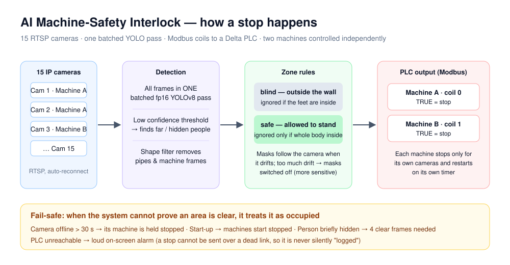

# AI Machine-Safety Interlock

**Client:** a factory production line · **Status:** deployed · **Role:** designed and built alone, from camera handling to PLC integration

[← All case studies](../../README.md)

> Cameras watch a production line. When a person is somewhere unsafe, the machine they are near is **stopped through the PLC** instead of the accident only being recorded.

## The problem

People get hurt by machines in a predictable way: someone reaches in to clear a jam while the machine is running. Guards get removed, light curtains cannot tell a person from material, and CCTV only records what has already happened.

## What I built

- **15 RTSP cameras** with automatic reconnect
- All frames go through **one batched fp16 YOLOv8 pass** instead of separate inference per camera. This is the main reason it responds quickly.
- Detections are tested against **zones** drawn for each camera
- A stop signal is sent over **Modbus** to a **Delta PLC**. Two machines are controlled independently, and a third machine is a config entry with no code change.
- A live video wall: red border = stopping a machine, amber = unhealthy camera. Ignored detections are still drawn in grey with the reason, so operators can always see why the system decided what it did.

## Engineering problems I solved

### "Outside the wall" vs "allowed to stand here"
Some cameras can see over the wall onto the road. People out there must never stop a machine. Other areas inside the plant are where operators are allowed to stand. These need opposite rules:

| Zone | Rule |
|---|---|
| **Blind** (outside the plant) | Ignored if the person's **feet** are inside it |
| **Safe** (permitted area) | Ignored only if the **whole body** is inside. One foot out and the machine stops. |

I built a mask editor so the client can draw these polygons on each camera themselves.

### Cameras that move
The cameras hang on cables and shift over time. A mask that slides off its wall is dangerous both ways. Each camera keeps a reference frame, the system estimates how far it has moved, and **the masks move with it**. If it moves too far to trust, the masks are switched off. That makes the system *more* sensitive, never less.

### Finding people without false stops
A high confidence threshold stopped machines being read as people, but it also missed real people who were far away, partly hidden or in poor light. That is the wrong trade for a safety system. I lowered the threshold and remove non-people by **shape** instead: a standing person is tall and narrow, a pipe or machine frame is not.

### Fail-safe behaviour
| Situation | Response |
|---|---|
| Camera offline for more than 30 s | Its machine is held stopped |
| Start-up | Machines start in the stopped state |
| Person briefly hidden | 4 clear frames in a row are needed before "clear" |
| PLC unreachable | Loud on-screen alarm. A stop cannot be sent over a dead link, so the system never pretends it did. |

### Honest model evaluation
A plant-specific model was trained to run alongside the general one. The metrics showed it had failed: the dataset had effectively **one usable labelled box**. So I **switched it off** rather than ship it, and built a pipeline that auto-labels recorded footage, keeps "nobody here" frames to teach the model what machines look like, and splits train/validation by source video so the score is honest.

## Technology

`Python` `YOLOv8` `OpenCV` `PyTorch (fp16)` `RTSP` `Modbus TCP` `Delta PLC`

---

*🔒 There is no demo video. The footage shows real workers on a real production floor, so it stays private. Source code is private for the same reason.*
