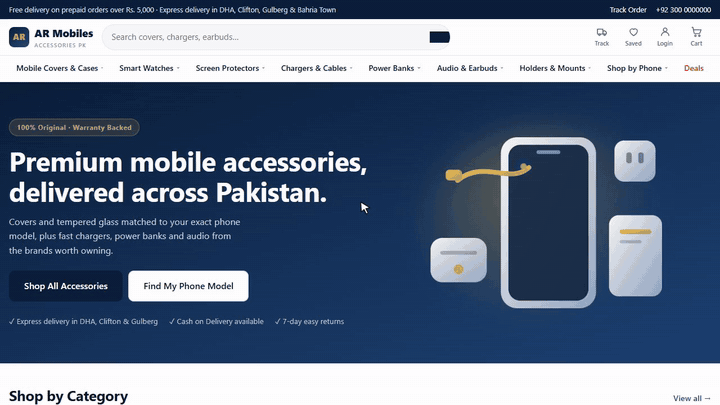

# AR Mobiles: online store for mobile accessories

**Type:** own product, e-commerce for the Pakistani market · **Role:** full-stack, built alone

[← All case studies](../../README.md)

▶ **[Watch the full demo](https://abdurrehman629.github.io/projects/ar-mobiles-online-store/)** · [download MP4](../../media/videos/ar-mobiles-demo.mp4)

## The problems a real accessories shop has

1. **Covers that don't fit.** A customer buys an iPhone 15 cover for an iPhone 15 Pro and returns it.
2. **Fake Cash-on-Delivery orders.** The rider travels, nobody answers, and the shop pays the delivery charge.
3. **Delivery cost depends on the area,** and a flat rate either loses money or loses customers.
4. **Customers find shops on Google,** so pages have to rank.

## How the store solves them

| Problem | Solution |
|---|---|
| Wrong fit | A **phone-model compatibility catalogue**: a cover only appears under phones it really fits, and the customer picks their model on the product page |
| Fake COD orders | **The delivery charge is paid online first** and the rider collects the rest, which stops fake orders without losing COD customers |
| Delivery cost | **Delivery tiers by city and area**, including express zones |
| Discovery | **Server-rendered pages** built for search engines, with fast first load on mobile data |
| Friction | **Guest checkout**, so customers don't need an account to buy |

## Technology

`Next.js 15` `TypeScript` `MySQL` `Server-side rendering`
