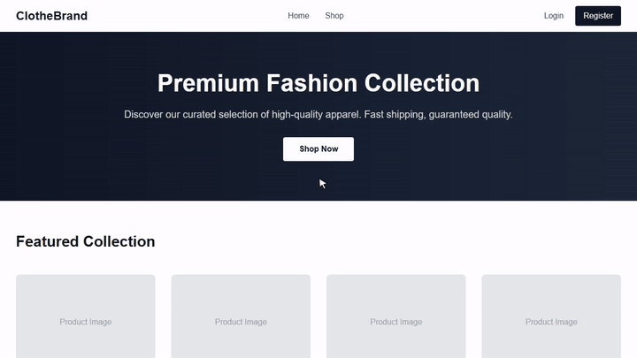

# ClotheBrand: fashion store with card payments

**Type:** own product · **Role:** full-stack, built alone

[← All case studies](../../README.md)

▶ **[Watch the full demo (MP4, 40 s)](../../media/videos/clothebrand-demo.mp4)**

## What it includes

- Product catalogue with search, filters and sorting
- Customer accounts with secure login (JWT sessions, hashed passwords)
- Cart and checkout with **Stripe card payments** (Payment Intents) and webhook confirmation
- Order history for customers
- **Admin dashboard** for products and orders, behind a separate admin role

## Technology

`Next.js 16 (App Router)` `React 19` `Tailwind CSS 4` `PostgreSQL` `Prisma 7` `NextAuth` `Stripe`
