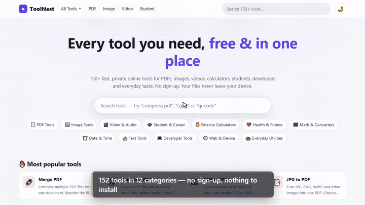

# ToolNest: 150+ free online tools

**Type:** own product · **Role:** built alone · **Source:** [public on GitHub](https://github.com/ABDURREHMAN629/toolnest)

[← All case studies](../../README.md)

▶ **[Watch the full demo (MP4, 1 min)](../../media/videos/toolnest-demo.mp4)**

## The idea

Most "free online tool" sites upload your files to their server. ToolNest runs **every tool inside the visitor's browser**, so files never leave the device. There's no server and no database, and hosting is free.

## What's inside

- **152 tools in 12 categories**: PDF (merge, compress, sign, convert), images (resize, convert, background removal, OCR), video and audio, text, calculators, student tools (CGPA, ATS resume checker) and developer tools
- Light and dark mode
- No sign-up and nothing to install

## How it's built

- A zero-dependency Node.js **build script generates every page**, plus `sitemap.xml` and `robots.txt`
- Each tool has its own SEO page, plus extra format pages like *PNG to JPG* and *MP4 to MP3*
- Deploys as plain static files to Cloudflare Pages, Netlify, Vercel or GitHub Pages
- Ready for Google Analytics and AdSense through one config file

## Technology

`JavaScript` `Node.js` `Static site generation` `In-browser processing` `SEO`
