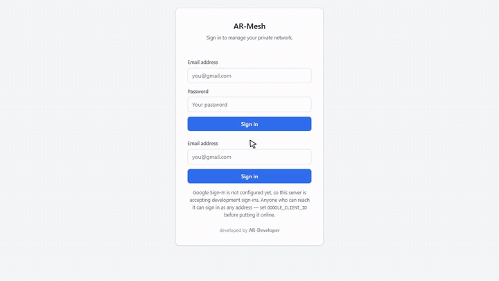

# AR-Developer Mesh: private network with fixed addresses

**Type:** own product · **Role:** built alone

[← All case studies](../../README.md)

▶ **[Watch the full demo](https://abdurrehman629.github.io/projects/ar-developer-mesh-private-network/)** · [download MP4](../../media/videos/ar-mesh-demo.mp4)

## The problem

Small businesses run a server on an ordinary PC: an ERP, a file share, a camera recorder. When the internet provider or router changes the IP address, every connection to that server breaks, and someone has to find the new address and update every device.

## What I built

A self-hosted private network that gives **every PC a permanent fixed address**. The server keeps the same address even when the internet provider changes theirs.

- **Central hub** with an admin control panel showing devices, owners, fixed IPs and online status
- **Add a PC in one step:** name it, choose its fixed address, and the panel creates its sign-in
- **Invite links** so people can enrol their own devices, with owner approval
- Revoke or block any device instantly
- **Windows installer** and an **Android client**
- Runs for free on an ordinary PC or a free cloud server

## Technology

`WireGuard` `SQLite` `Node.js` `Windows installer` `Android`
