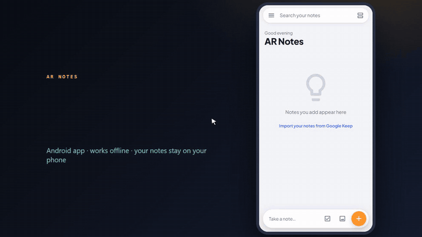
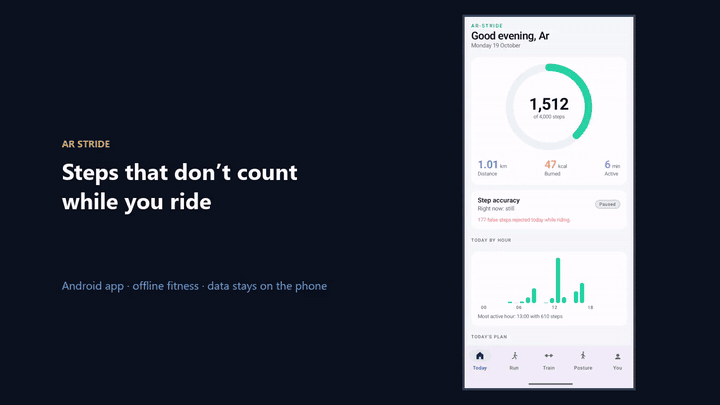
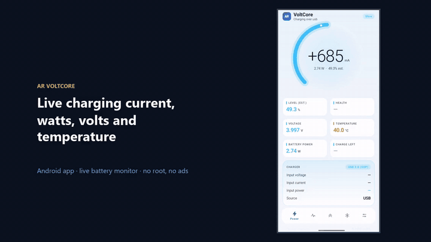
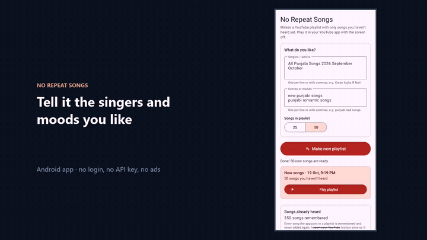
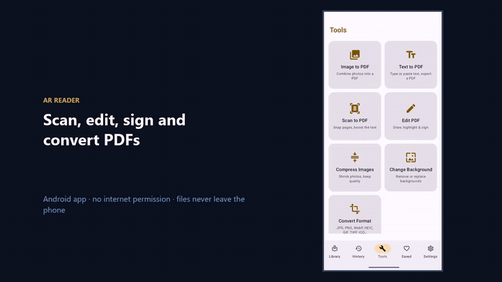

# Android apps

Offline-first apps that keep the user's data on the phone. Each one is published with a free APK.

[← All case studies](../../README.md)

---

## AR Salary Tracker

For factory and daily-wage workers: enter the daily wage and overtime rate once, tap **P** for each day worked, and see totals for every 15-day period and the full month. English and Urdu, no internet needed, with backup and restore.

▶ [Watch the demo](https://abdurrehman629.github.io/projects/ar-salary-tracker/) · [download MP4](../../media/videos/salary-tracker-demo.mp4) · [Try it online](https://abdurrehman629.github.io/salary-tracker/) · [Source](https://github.com/ABDURREHMAN629/salary-tracker)

`JavaScript` `Android` `Offline-first`

---

## AR Notes: Google Keep alternative

Notes, checklists, colours, labels and reminders that work **without a calendar app**. One-tap import of Google Keep notes from Google Takeout, five visual styles with light and dark mode, and backup and restore.

▶ [Watch the demo](https://abdurrehman629.github.io/projects/ar-notes-android/) · [download MP4](../../media/videos/ar-notes-demo.mp4) · [Source and APK](https://github.com/ABDURREHMAN629/ar-notes-google-keep-alternative)

`JavaScript` `Capacitor` `Android`

---

## AR Stride: offline fitness

Step counting that **refuses to count while you're riding** a bike or vehicle, GPS runs on offline maps, a 30-day home training plan, yoga, and posture and breathing exercises.

▶ [Download the demo video (MP4)](../../media/videos/ar-stride-demo.mp4) · [Source and APK](https://github.com/ABDURREHMAN629/AR-Stride/releases/latest)

`Kotlin` `Jetpack Compose` `Activity recognition` `Offline maps`

---

## VoltCore: battery and charging monitor

Live charging current in mA, watts, volts, temperature and battery health, per-app battery usage, and daily and hourly history charts. No root and no ads.

▶ [Download the demo video (MP4)](../../media/videos/voltcore-demo.mp4) · [Source and APK](https://github.com/ABDURREHMAN629/voltcore/releases/latest)

`Kotlin` `Jetpack Compose` `SQLite`

---

## No Repeat Songs

Stops YouTube autoplay from repeating the same songs. It builds playlists of only songs you haven't heard (Punjabi, Hindi, any artist or genre) and plays them in your YouTube app with the screen off. No login and no API key.

▶ [Download the demo video (MP4)](../../media/videos/no-repeat-songs-demo.mp4) · [Source and APK](https://github.com/ABDURREHMAN629/no-repeat-songs-youtube-autoplay/releases/latest)

`Kotlin` `Android`

---

## AR Reader: document reader

Opens PDF, EPUB, Word, Excel, PowerPoint, comics and images, with themes and in-document search. Built-in tools: scan to PDF, draw on a PDF, compress and convert images, remove photo backgrounds. **The app has no internet permission**, so files never leave the phone.

▶ [Download the demo video (MP4)](../../media/videos/ar-reader-demo.mp4)

`Kotlin` `Jetpack Compose` `Material 3` `ML Kit`
